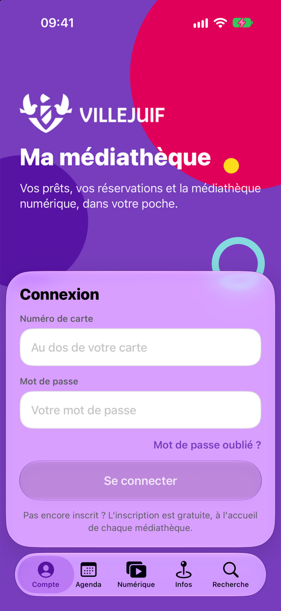
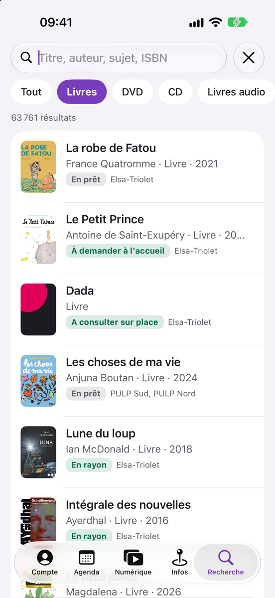
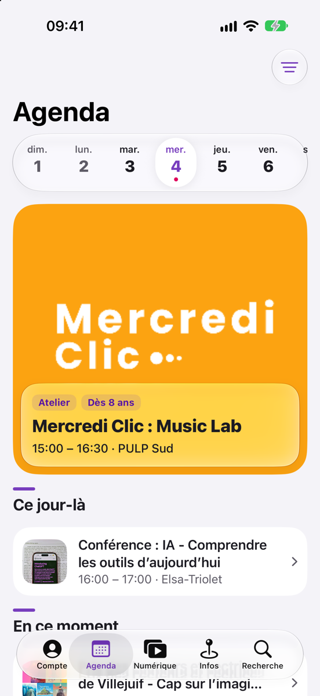
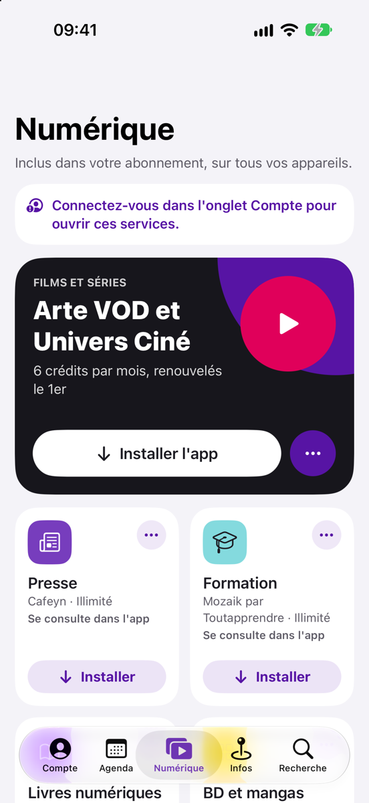
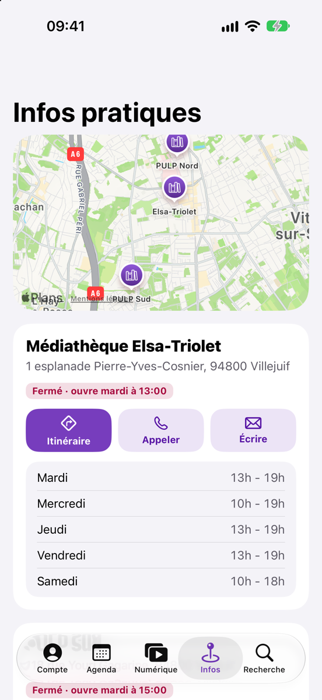
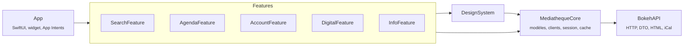

<div align="center">


# Médiathèque

**Les médiathèques de Villejuif dans la poche.**<br>
Vos prêts, vos réservations, l'agenda, le catalogue et la médiathèque numérique, dans une app iOS native.


</div>

<p align="center">
  
  
  
  
  
</p>

> [!IMPORTANT]
> **Projet personnel et non officiel.** Cette app n'est ni éditée, ni validée, ni soutenue par la Ville de Villejuif ou son réseau de médiathèques. Elle s'appuie sur le portail public [mediatheque.villejuif.fr](https://mediatheque.villejuif.fr/). Le nom, le blason et la charte graphique de Villejuif appartiennent à la Ville.

---

## Pourquoi

Le portail des médiathèques de Villejuif est complet, mais pensé pour un ordinateur. *Médiathèque* reprend ce qu'on y fait le plus souvent depuis un téléphone : vérifier ce qu'il faut rendre, prolonger un prêt, réserver un livre, voir ce qui se passe mercredi, ouvrir un film du catalogue numérique. Tout se fait en quelques gestes, aux couleurs de la ville et avec le design Liquid Glass d'iOS 26.

## Fonctionnalités

### 👤 Mon compte
- **Carte d'abonné** en Code 39, comme la carte en plastique. Elle s'affiche en plein écran pour le comptoir, avec la luminosité au maximum, et peut pivoter d'un demi-tour.
- **Prêts** regroupés par échéance (en retard, cette semaine, plus tard), à prolonger un par un ou tous d'un coup.
- **Réservations** avec le lieu de retrait, et annulation après confirmation.
- **Sélections, avis, suggestions d'achat, informations personnelles et réglages.**
- **Connexion** avec l'autoremplissage du trousseau iCloud, puis **Face ID** pour les fois suivantes.
- **Rappels** de retour à J-3, alerte quand une réservation est disponible, et agenda de la semaine le lundi, tout ça désactivable. L'app explique pourquoi elle demande les notifications avant que l'alerte d'iOS n'apparaisse.

### 🔎 Recherche
- Tout le catalogue, avec des filtres par type de document et par médiathèque.
- La **disponibilité en temps réel** de chaque exemplaire (en rayon, en prêt, date de retour), et pas le statut de la nuit précédente.
- Une fiche détaillée pour chaque œuvre, et la **réservation** avec le choix du lieu de retrait.
- Des tuiles *Explorer* pour démarrer : nouveautés, films, musique, e-books, livres audio, films en ligne.

### 📅 Agenda
- Les animations des trois médiathèques, jour par jour, avec un mini-calendrier sur iPad.
- Des filtres par lieu, type d'animation et public.
- L'ajout au calendrier, et le partage.

### ▶️ Numérique
- Arte VOD, Cafeyn, Mozaik, BiblioAccess, Izneo, Eurêka et musicMe, déjà inclus dans l'abonnement.
- **Ouvrir ou installer** : l'app sait si l'app du partenaire est installée. Si oui, elle l'ouvre directement. Sinon, elle la présente puis ouvre sa fiche App Store sans quitter *Médiathèque*.
- La connexion aux services web se fait par le portail : pas de deuxième mot de passe à retenir.

### 🏛️ Infos pratiques
- Les trois médiathèques (Elsa-Triolet, PULP Nord, PULP Sud) sur une carte, avec leurs horaires.
- Le statut **« Ouvert » ou « Fermé · ouvre mardi à 13:00 »**, calculé en direct.
- Itinéraire, appel ou e-mail en un geste.

### Et aussi
| | |
|---|---|
| 📱 **Widget** | « Prochains retours » sur l'écran d'accueil |
| 🗣️ **Siri et Raccourcis** | *« Quand dois-je rendre mes livres dans Médiathèque ? »*, *« Montre ma carte Médiathèque »*, *« Agenda Médiathèque »* |
| 🖥️ **iPad** | barre latérale permanente, recherche et fiche côte à côte, raccourcis clavier (⌘F, ⌘1…5) |
| 📳 **Retours haptiques** | discrets, seulement quand ils ont un sens (prolongation réussie, carte scannée…) |
| 📶 **Cache** | l'agenda, les horaires et les recherches récentes restent affichés quand le réseau flanche |
| ♿ **Accessibilité** | Dynamic Type, VoiceOver, mode sombre |

## Comment ça marche

Il n'y a **pas de serveur** : l'app parle directement au portail des médiathèques, qui tourne sous Bokeh, un portail open source de bibliothèques.

| Besoin | Source |
|---|---|
| Recherche | `…/recherche/simple/…/format/json`, l'API JSON publique de Bokeh |
| Disponibilité en temps réel | `/noticeajax/availability` et `/noticeajax/exemplaires` |
| Agenda | la page HTML de l'agenda (une seule requête), puis l'iCal de chaque événement pour le détail |
| Horaires | les pages HTML des médiathèques |
| Compte | `/api/user/*` avec le cookie de la session web, obtenu par le formulaire de connexion du portail |
| Numérique | `/modules/{service}`, qui renvoie l'URL de connexion (SSO) chez le fournisseur |

Tout ce qui dépend du format du site (DTO, analyse du HTML, iCal) est isolé dans `BokehAPI`. Si le portail change, seule cette couche bouge.

## Architecture

SwiftUI, **MVVM** et injection de dépendances avec [swift-dependencies](https://github.com/pointfreeco/swift-dependencies). Pas de SwiftData ni de Core Data : le portail reste la seule source de vérité.



```
.
├── App/                     # point d'entrée, onglets, écran de lancement, raccourcis Siri
├── Config/                  # identifiants et signature (xcconfig ; Local.xcconfig non versionné)
├── Docs/                    # captures et icône du README
├── Packages/Mediatheque/    # Swift Package local, une target par couche
│   ├── Sources/
│   │   ├── BokehAPI/        # transport et formats du portail
│   │   ├── MediathequeCore/ # domaine, clients de dépendances, cache, notifications, textes d'erreur
│   │   ├── DesignSystem/    # charte de Villejuif, composants, écrans d'erreur
│   │   └── …Feature/        # un module par onglet : vues et ViewModels
│   └── Tests/               # Swift Testing, sur des fixtures réelles anonymisées
├── Widget/                  # widget « Prochains retours »
├── ci_scripts/              # Xcode Cloud : vérification du style, génération du projet, identifiants
├── project.yml              # projet Xcode généré par XcodeGen
├── .swiftformat             # format du code
├── .swiftlint.yml           # règles de SwiftLint
├── .periphery.yml           # recherche du code mort
└── .git-blame-ignore-revs   # commits de formatage ignorés par git blame
```

- **ViewModels** `@MainActor @Observable` : ils exposent un état et des intentions, et déclarent leurs dépendances avec `@Dependency`.
- **Vues** sans logique : elles affichent l'état et relaient les actions, et n'accèdent jamais aux dépendances.
- **Clients** en structs de closures (`@DependencyClient`), avec une implémentation réelle, une pour les aperçus et une pour les tests.
- **Persistance** : un cache JSON des données publiques dans `Library/Caches`, et un instantané du compte dans l'App Group, partagé avec le widget. Rien d'autre.

## Démarrer

**Prérequis** : Xcode 26 ou plus récent (SDK iOS 26) et [XcodeGen](https://github.com/yonaskolb/XcodeGen).

```bash
brew install xcodegen
```

```bash
git clone https://github.com/romainbiard/villejuif-mediatheque.git && cd villejuif-mediatheque
```

```bash
xcodegen generate && open Mediatheque.xcodeproj
```

Choisissez le schéma **Mediatheque**, puis un simulateur ou votre iPhone.

Les identifiants et la signature viennent de `Config/Shared.xcconfig`, avec des valeurs neutres (`com.example`) qui suffisent pour le simulateur. Pour installer l'app sur un appareil, copiez `Config/Local.xcconfig.example` en `Config/Local.xcconfig` et indiquez-y votre préfixe et votre équipe. Ce fichier est ignoré par git, et l'App Group suit le préfixe.

```bash
cp Config/Local.xcconfig.example Config/Local.xcconfig
```

Sans compte, la recherche, l'agenda, les infos pratiques et la présentation du numérique fonctionnent. Pour l'espace abonné, il faut une carte des médiathèques de Villejuif.

### Tests

Plus de 140 tests, sur des fixtures JSON, HTML et iCal tirées du portail réel et anonymisées.

```bash
cd Packages/Mediatheque && xcodebuild test -scheme Mediatheque-Package -destination 'platform=iOS Simulator,name=iPhone 17 Pro' -testLanguage fr -testRegion FR -skipMacroValidation
```

Remplacez le simulateur par l'un de ceux installés sur votre Mac (`xcrun simctl list devices`). Les tests vérifient des textes en français : `-testLanguage fr` les rend indépendants de la langue du simulateur.

### Style

Le format est fixé par [SwiftFormat](https://github.com/nicklockwood/SwiftFormat) (`.swiftformat`) et vérifié par [SwiftLint](https://github.com/realm/SwiftLint) (`.swiftlint.yml`).

```bash
brew install swiftformat swiftlint periphery
swiftformat .   # met le code au format
swiftlint       # signale ce que SwiftFormat ne corrige pas
periphery scan  # cherche le code mort (après xcodegen generate)
```

Xcode Cloud lance les deux avant chaque build : un commit mal formaté n'arrive pas sur TestFlight.

### Xcode Cloud et TestFlight

Le projet Xcode n'est pas versionné : sur Xcode Cloud, `ci_scripts/ci_post_clone.sh` vérifie le style, installe XcodeGen, génère le projet et écrit `Config/Local.xcconfig` à partir des variables d'environnement du workflow. Le numéro de build suit `CI_BUILD_NUMBER`.

| Variable | Exemple |
|---|---|
| `BUNDLE_ID_PREFIX` | `com.votrenom` |
| `DEVELOPMENT_TEAM` | identifiant d'équipe Apple Developer (10 caractères) |

Le schéma partagé `Mediatheque` lance les tests du package (en français) et archive l'app avec son widget.

## Confidentialité

- **Aucun serveur intermédiaire, aucun traceur, aucune statistique.** Les données vont seulement de votre iPhone au portail des médiathèques.
- Les identifiants restent dans le **trousseau iOS**, sur cet appareil seulement (ni sauvegardes, ni iCloud). Avec Face ID activé, l'app se verrouille au lancement et après deux minutes en arrière-plan.
- Siri ne lit pas vos prêts tant que l'iPhone est verrouillé, et le widget masque les titres sur l'écran verrouillé.
- Le cache ne contient que des **données publiques** (agenda, horaires, recherches). Les données du compte vivent dans l'App Group et sont effacées à la déconnexion.
- Les URL de connexion aux services numériques peuvent contenir des données personnelles : elles sont résolues au moment du tap et **jamais journalisées**.

## Licence

Code sous licence [MIT](LICENSE). Le nom, le blason et l'identité visuelle de la Ville de Villejuif, ainsi que les marques des services numériques cités, appartiennent à leurs propriétaires respectifs.
